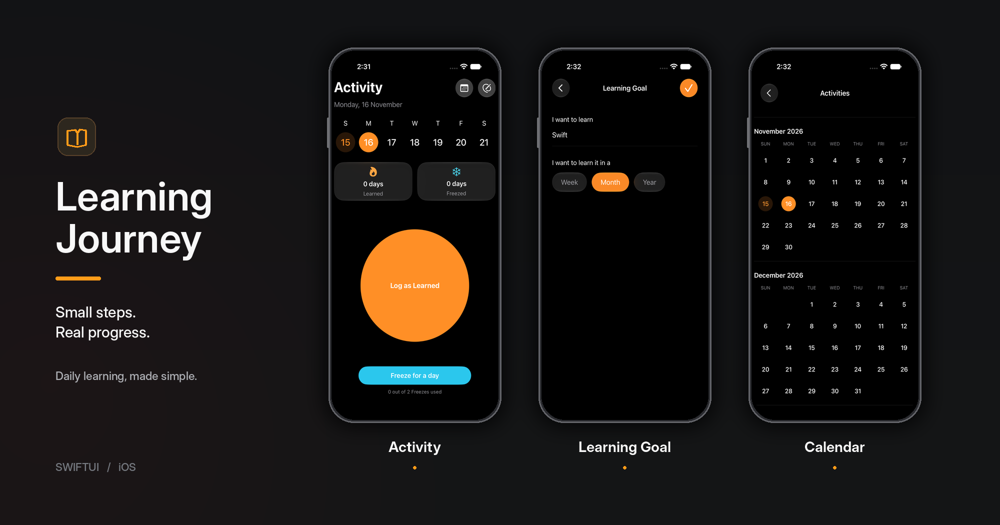

# 📚 Learning Journey

### Small Steps, Big Progress.

A simple iOS app designed to help you build a consistent learning habit, one day at a time.

**Built with Swift & SwiftUI**

  
  
  

---

## ✦ About the App

Learning Journey is an iOS app designed to help users build consistent learning habits through daily progress tracking.

The app encourages users to stay committed to their personal learning goals while allowing flexibility for rest days.

## Key Features

&nbsp;&nbsp; **Daily Learning**  
Record your learning progress each day.

&nbsp;&nbsp; **Freeze a Day**  
Take a break without losing your learning streak.

&nbsp;&nbsp; **Learning Calendar**  
View your learning history in a monthly calendar.

&nbsp;&nbsp; **Personal Goals**  
Set and update your learning goal duration.

&nbsp;&nbsp; **Streak Tracking**  
Track your learning consistency.

---

## App Preview

  

